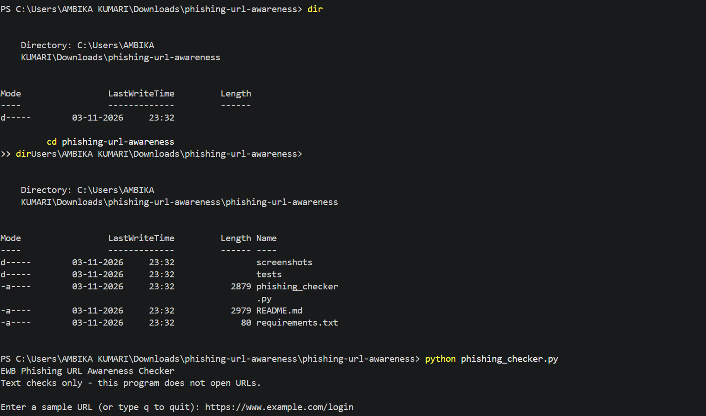
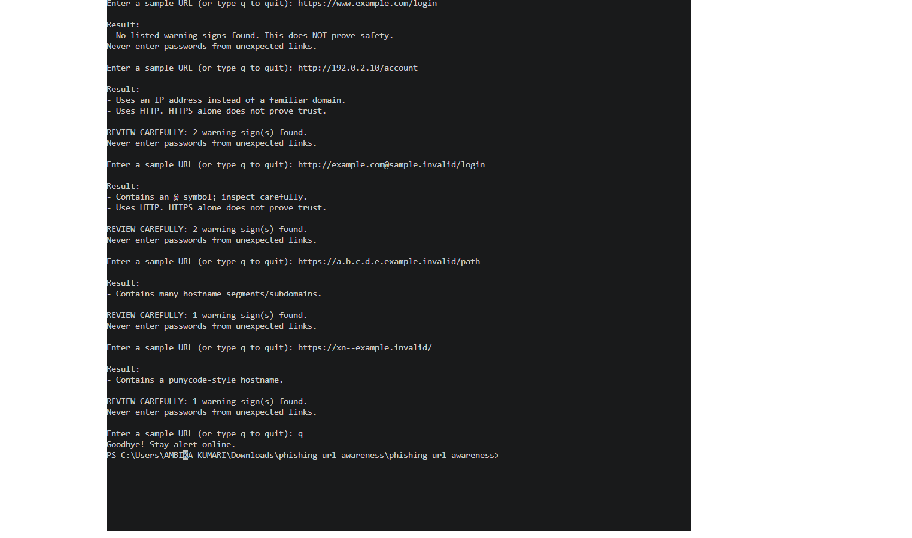

# EWB Phishing URL Awareness Checker

## Overview
Phishing is a trick where criminals use fake links or messages to make people share passwords, card numbers or OTPs. This project is a small Python command-line tool that reads the text of a URL and points out a few visible warning signs. It never opens the URL.

## Features
- Detects an @ symbol in the URL
- Flags unusually long URLs (over 100 characters)
- Flags IP-address hostnames
- Flags many hostname segments (5 or more)
- Flags punycode-style hostnames (xn--)
- Flags the HTTP scheme
- Loop mode: check many URLs in one run and type q to quit
- "REVIEW CAREFULLY" summary with a count of warning signs
- Safe handling of malformed input such as `http://[bad`

## Requirements
Python 3.10 or later. No extra packages.

## How to Run
Windows: `python phishing_checker.py`

Mac/Linux: `python3 phishing_checker.py`

## Example Output
```
EWB Phishing URL Awareness Checker
Text checks only - this program does not open URLs.

Enter a sample URL (or type q to quit): http://192.0.2.10/account

Result:
- Uses an IP address instead of a familiar domain.
- Uses HTTP. HTTPS alone does not prove trust.

REVIEW CAREFULLY: 2 warning sign(s) found.
Never enter passwords from unexpected links.
```

## Testing
| # | Input | Expected | Actual | Result |
|---|-------|----------|--------|--------|
| 1 | https://www.example.com/login | No warning signs | No listed warning signs found | PASS |
| 2 | http://192.0.2.10/account | IP address + HTTP | IP address and HTTP warnings | PASS |
| 3 | http://example.com@sample.invalid/login | @ symbol + HTTP | @ symbol and HTTP warnings | PASS |
| 4 | https://a.b.c.d.e.example.invalid/path | Many hostname segments | Many hostname segments warning | PASS |
| 5 | https://xn--example.invalid/ | Punycode-style hostname | Punycode warning | PASS |

The full table is in `tests/test_samples.md`.

## Screenshots



## Improvements
1. **Loop with quit** - the program now keeps asking for URLs until the user types q, so it does not need restarting. Tested by entering several URLs in one run, then q.
2. **Review carefully summary** - a helper function `has_warnings()` separates real warnings from information messages, and a summary line shows how many warnings were found. Tested by re-running all five samples.
3. **Malformed input handling** - `urlparse` is wrapped in `try / except ValueError`, so input like `http://[bad` prints a friendly message instead of crashing. Tested with that exact input.

## Limitations
This is an educational tool. It only reads URL text. It does not visit URLs, scan for malware or prove that a URL is safe. No warning signs found does NOT mean a URL is safe.

## Ethical Use
Use sample strings only. Do not collect credentials. Do not use this project to deceive anyone or to test websites without permission.

## Author
Ambika Kumari, batch 1 course Ewb AI powered cybersecurity course, EWB Courses
